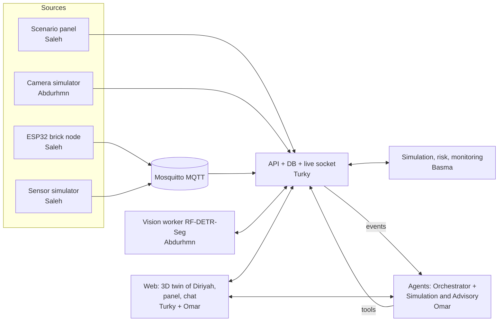

# حَدَق Hadaq

> **Start here:** [HANDOVER.md](HANDOVER.md) has the current state, known issues and next steps for each of us. Update it at the end of every session.

**A digital eye that detects the finest details.**
**عين رقمية تكتشف أدق التفاصيل**

Hadaq is an AI multi-agent digital twin for the mud-brick heritage of At-Turaif, Diriyah (agentX hackathon, Culture and Heritage track). It shows Diriyah as a 3D map; click the focus building and you get its live sensors, camera feed, simulated rain impact on each wall zone, risk scores, and agents that investigate on their own and propose actions for a conservation expert to approve.

> Round 1 runs on simulated sensors, edited photos and an uncalibrated moisture model, all labeled as such. One sensor node in a mud brick we made is real. See "Honesty" below.

## How it fits together



## Repo map

| Path | What | Owner | Guide |
| --- | --- | --- | --- |
| `contracts/` | Formats, topics, IDs everyone codes against | All (Omar approves changes) | [contracts/README.md](contracts/README.md) |
| `packages/hadaq_schemas/` | Shared Pydantic models | Turky | |
| `services/api/` | FastAPI gateway, MQTT bridge, SQLite/Postgres, websocket | Turky | [docs/team/turky.md](docs/team/turky.md) |
| `services/simulation/` | Weather, moisture model, ABC risk, monitoring rule | Basma | [docs/team/basma.md](docs/team/basma.md) |
| `services/vision/` | RF-DETR-Seg, camera simulator, vision worker | Abdurhmn | [docs/team/abdurhmn.md](docs/team/abdurhmn.md) |
| `services/agents/` | LangGraph agents, verifier, chat API | Omar | [docs/team/omar.md](docs/team/omar.md) |
| `devices/` | ESP32 brick node, sensor simulator | Saleh | [docs/team/saleh.md](docs/team/saleh.md) |
| `apps/web/` | React + three.js app (3D twin of Diriyah) | Turky (shell), Omar (twin, chat), Saleh (scenario panel) | |
| `docs/` | Team guides, 3D scan guide, demo script | All | |

## Quick start

Needs: Python 3.11+, Node 20+, Docker, Git. Windows users: use WSL, or run the commands inside the `Makefile` by hand.

```bash
git clone https://github.com/oShuail/Hadaq-AgentX.git && cd Hadaq-AgentX
make setup        # venv + all Python packages, npm install, git hooks, .env files
make up           # MQTT broker in Docker
```

Then one terminal each:

```bash
make api          # http://localhost:8000/docs
make agents       # http://localhost:8100/docs  (HADAQ_LLM=mock works without a key)
make web          # http://localhost:5173
make sensors      # simulated sensors
make vision       # vision worker (mock detector until the model is trained)
make camera       # camera simulator (needs photos in assets/camera/B01-CAM01/)
```

Web app: the 3D map needs no keys. It is baked from open data (OpenStreetMap, Microsoft footprints, Esri imagery, AWS terrain) into `apps/web/public/site/`, which is in the repo. To refresh it, see [tools/site_data/README.md](tools/site_data/README.md).

Check everything: `make test` and `cd apps/web && npm run build`.

## Team

| Member | Role in Hadaq |
| --- | --- |
| Omar | AI, digital twin, NLP: agents, twin view, chat, integration lead |
| Basma | AI: rain simulation, weather data, risk scoring, final PDF |
| Abdurhmn | AI and vision: defect detection, camera feed, demo video |
| Saleh | IoT, microcontrollers, iOS: brick sensor node, sensor simulator, scenario panel |
| Turky | Backend: API, database, MQTT, shared formats, map shell |

## Rules

- Read [CONTRIBUTING.md](CONTRIBUTING.md). Branch per task, PR to `main`, `make test` before pushing.
- **No AI tool is ever a contributor**: no AI authors, no `Co-Authored-By` AI trailers, no "Generated with" lines. A git hook and a CI job enforce it.
- Never attach anything to the real heritage walls. Drones and on-site sensors need DGDA permission.

## Honesty

Every value carries a provenance label: `measured`, `derived`, `model_output`, `assumed` or `synthetic`. The moisture model (`bucket_v0`) is a transparent demo model with assumed parameters, not a validated hygrothermal simulation. Risk uses an adapted ABC method with our own level bands. The architecture document explains the Round 2 path to calibrated physics.
