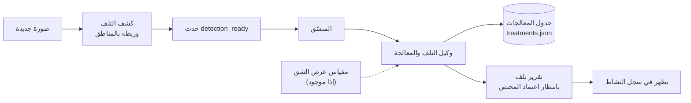

# حَدَق: الفكرة، الموجود، والخطة

> **اقرأ هذا قبل أي مهمة جديدة.** يجمع متطلبات التحدي كما نشرها المنظمون، ووش عندنا في الكود، ووش انبنى، والفجوات، والخطة بالأولوية.
>
> آخر تحديث: 2026-11-21 · الحالة: **مسودة للنقاش**. القرارات المفتوحة في القسم 12 تحتاج رد من الفريق.
>
> التفاصيل التقنية للوكلاء (بالإنجليزي): [services/agents/README.md](../services/agents/README.md).

## الخلاصة

- **التحدي** يبي وكيل ذكاء اصطناعي ياخذ **صوراً حقيقية** لجدران الطين ويطلع منها: أنواع التلف وأماكنها، ومعالجة محددة لكل نوع، والمواد والأدوات، على **خريطة واضحة بمفتاح ألوان**. والمختص **يصحح ويعتمد**، والوجوه في الصور **تنخفي**.
- **حدق كان** مبنياً حول الحساسات ومحاكاة المطر. التحدي يقول إن الحساسات **ليست شرطاً أساسياً**، ومحاكاة المطر ما هي مطلوبة أصلاً.
- **انبنى اليوم:**
  - **وكيل التلف والمعالجة:** ياخذ التلف من آخر صورة ويربطه بجدول المعالجات، ويطلع لكل تلف النوع والمكان والشدة والمعالجة والمواد والأدوات والمصدر. أول ما تنحلل صورة جديدة، يرسل تقرير لمراجعة المختص **لحاله**. يرد بالعربي والإنجليزي.
  - **خريطة التلف بمفتاح ألوان:** التقرير مرسوم على صورته بعلامات مرقّمة، ونفس الألوان على شبكة الجدار وعلى الجدار في الـ3D (طبقة "Damage").
  - **إخفاء الوجوه:** قبل ما تنحفظ أي صورة.
  - **تجهيز النموذج اللغوي الحقيقي:** إعدادات صحيحة للنموذج، وبديل تلقائي إذا تعطل، واختبار عقد يتأكد من كل طلب.
  - **التحقق:** 47 اختباراً كلها ناجحة، وتشغيل حي كامل للنظام بالمتصفح.
- **الباقي الأهم:**
  - صور حقيقية.
  - واجهة مراجعة المختص (تحتاج موافقة عمر على `contracts/`).
  - قياس الدقة مقارنة بمختص.
  - تشغيل النموذج الحقيقي بالمفتاح.

## 1. الفكرة

**حَدَق: عين رقمية تكتشف أدق التفاصيل.**

توأم رقمي لمباني الطين في حي الطريف بالدرعية، فيه وكلاء ذكاء اصطناعي يفحصون الجدار من الصور، يحددون التلف ومكانه، ويقترحون المعالجة بموادها وأدواتها. **الوكيل يقترح، والمختص يقرر.**

- **المسار:** هاكاثون agentX، مسار الثقافة والتراث.
- **المبنى المحوري:** قصر سلوى (B01). الواجهة W01 مقسومة إلى **4 صفوف × 8 أعمدة** = 32 منطقة. `R1` هو صف القاعدة، و`C1` هو العمود اليسار لما تقابل الواجهة. مثال: `B01-W01-R2C5` = الصف الثاني من تحت، العمود الخامس من اليسار.
- **مبدأ الصدق:** كل رقم يقوله الوكيل له دليل (evidence ID) ينفتح، وكل قيمة عليها وسم مصدرها:

| الوسم | معناه |
|---|---|
| `measured` | مقاس من جهاز حقيقي |
| `derived` | مشتق من قياس |
| `model_output` | مخرجات نموذج |
| `assumed` | مفترض أو من مرجع |
| `synthetic` | مصطنع للديمو |

## 2. التحدي كما نشره المنظمون

> منقول من صورة صفحة التحدي، فممكن تختلف كلمة أو كلمتين عن الأصل. الأجزاء **العريضة** هي اللي حددها الفريق كأولوية.

### نظرة عامة

تتعرض الجدران الطينية في حي الطريف للتلف بسبب الزوار والعوامل البيئية. ويُفحص التلف اليوم يدوياً وعلى فترات متباعدة، ويستغرق رسم مخططات التلف وقتاً طويلاً ويحتاج إلى مختصين، لذلك يُكتشف التلف متأخراً.

### المطلوب: حل مبتكر يعتمد على وكيل ذكاء اصطناعي قادر على

1. **تحديد أنواع التلف** التي تحتاج إلى معالجة، مثل **التشقق، وتساقط الطلاء، والتآكل الرطوبي**.
2. **اقتراح المعالجة:** طريقة معالجة محددة وواضحة لكل نوع من أنواع التلف.
3. **تحديد المواد والأدوات** اللازمة لكل معالجة.
4. **أجهزة الاستشعار:** يمكن إضافة تقنيات مثل الاستشعار الحراري، مع عدم الاعتماد على أجهزة الاستشعار كشرط أساسي.
5. لا يشمل التحدي سلوك الزوار عبر الكاميرات.
6. **نطاق التحدي:** مخرجات أولية تستند إلى صور واقعية للمباني، **مع تحديد طريقة معالجة التلف ونوع المواد وأماكنها**.

### معايير التقييم

| المعيار | النص |
|---|---|
| دقة التحديد | تحديد أنواع التلف والمواد بشكل صحيح مقارنةً بتقييم المختصين |
| وضوح الخريطة | خريطة موحدة وسهلة القراءة بمفتاح ألوان واضح |
| سهولة المراجعة | يستطيع المختص تصحيح النتائج بسهولة قبل اعتمادها |
| الخصوصية | إخفاء وجوه الأشخاص الذين يظهرون في الصور |

### كيف نفهمها

- **"المواد" لها معنيان، ونغطي الاثنين:**
  - (أ) **مواد الجدار نفسه وأماكنها:** لبن، لياسة طينية، حجر، خشب، إسمنت. هذي "خريطة مواد".
  - (ب) **مواد المعالجة وأدواتها لكل تلف:** مربوطة بمكان التلف على الخريطة. **هذي انبنت اليوم.**
- **"التآكل الرطوبي"** يقابله عندنا: تآكل القاعدة، وأخاديد الأمطار، وتزهّر الأملاح (القسم 8).
- **"صور واقعية":** الديمو لازم يشتغل على صور حقيقية لمباني طين، مو صور معدّلة.
- **"مقارنة بتقييم المختصين":** نحتاج مجموعة صور يحكم عليها مختص، ونقيس عليها دقتنا بأرقام.
- **الحساسات إضافة مو أساس:** كل شي لازم يشتغل من الصور وحدها.

## 3. وش موجود اليوم

| الجزء | وش يسوي | الحالة | المالك | المكان |
|---|---|---|---|---|
| التوأم الثلاثي الأبعاد | خريطة الدرعية بـthree.js من بيانات مفتوحة، ونموذج قصر سلوى بشبكة المناطق ومربعات الانتباه | ✅ يشتغل | عمر | `apps/web/src/twin3d/` |
| صفحة المبنى | النموذج، حالة الجدار (رطوبة/خطر)، الحساسات، الكاميرا، النشاط، الشات | ✅ يشتغل | عمر، تركي | `apps/web/src/building/` |
| الـAPI | يستقبل القراءات والصور والاكتشافات والأحداث، يعطي كل سجل رقم دليل، و`GET /evidence/{id}` يفتح أي دليل | ✅ يشتغل | تركي | `services/api/` |
| الحساسات | 6 حساسات: S01–S03 في عقدة ESP32 داخل طوبة، وS04–S06 من المحاكي (S06 مقياس عرض الشق في R2C5) | ✅ المحاكي يشتغل | صالح | `devices/` |
| الكاميرا | محاكي كاميرا ثابتة `B01-CAM01` يرفع صوراً من مجلد | ⚠️ الصور مو في git، و`wall_bbox_px` قيمة افتراضية | عبدالرحمن | `services/vision/` |
| كشف التلف | RF-DETR-Seg بخمس فئات: `crack`، `erosion`، `plaster_loss`، `moisture_stain`، `missing_material`. يربط كل اكتشاف بمنطقة ويقارن بالصورة السابقة | ⚠️ الموديل **ما تدرّب**. الشغّال `MockDetector` | عبدالرحمن | `services/vision/` |
| محاكاة المطر | نموذج رطوبة لكل منطقة، يعيد عاصفة حقيقية (2023-01-05)، وسيناريوهات منها "إصلاح التصريف" | ✅ يشتغل (غير معاير) | بسمة | `services/simulation/` |
| درجة الخطر | طريقة ABC معدّلة لكل منطقة | ✅ يشتغل (حدود مفترضة) | بسمة | `services/simulation/` |
| **وكيل التلف والمعالجة** | **جديد اليوم.** التفاصيل في القسم 4 | ✅ يشتغل ومختبر | صاحب مهمة الوكلاء | `services/agents/` |
| **خريطة التلف** | **جديد اليوم.** تقرير الوكيل على صورته بمفتاح ألوان، وطبقة Damage على الشبكة والـ3D | ✅ | صاحب مهمة الوكلاء | `apps/web/src/building/DamageMap.tsx` |
| **إخفاء الوجوه** | **جديد اليوم.** قبل حفظ أي صورة (YuNet) | ✅ | صاحب مهمة الوكلاء | `services/api/hadaq_api/privacy.py` |
| المنسّق ووكيل المحاكاة | المنسّق يوزّع الشغل، ووكيل المحاكاة يشغّل محاكاة المطر ويقيّم الخطر | ✅ يشتغل | صاحب مهمة الوكلاء | `services/agents/` |
| الـverifier | يرفض أي رقم في جواب الوكيل ما طلع من أداة | ✅ | صاحب مهمة الوكلاء | `services/agents/hadaq_agents/verifier.py` |

## 4. وكيل التلف والمعالجة (انبنى اليوم)

### وش يسوي

أي تلف يظهر في آخر صورة محللة، الوكيل يطلع له:

- **النوع:** واحد من الـ11 نوعاً في جدول المعالجات.
- **المكان:** رقم المنطقة، والصف من القاعدة، والعمود من اليسار.
- **الشدة:** للشقوق، من عرض الشق.
- **المعالجة والمواد والأدوات:** من الجدول، حرفياً.
- **المصدر:** الهيئة، أو مقترح من الفريق يحتاج تأكيد مختص.
- **الأولوية:** عالية، أو متوسطة، أو منخفضة.

بعدها يرسل **تقرير التلف** لمراجعة المختص.

### كيف يشتغل



1. **التصنيف:** الكاشف يعطي فئة (مثلاً `erosion`) ومنطقة. الوكيل يحوّلها لنوع من الجدول بقاعدة شفافة:
   - `erosion` في صف القاعدة = **تآكل القاعدة**، وأعلى منه = **أخاديد الأمطار**.
   - `missing_material` في الصف العلوي = **فقدان الشرفات والزخارف**، وتحته = **الفجوات والجحور**.
   - `moisture_stain` = **تزهّر الأملاح** قرب القاعدة أو **النمو الحيوي** فوق، مع علامة "يحتاج تأكيد المختص".
2. **الشدة (للشقوق):** العرض يجي من مقياس الشق في نفس المنطقة، وإذا ما فيه، يُقدَّر من قناع الكشف. الحدود: أقل من 2 مم = دقيق (حقن)، ومن 2 مم = عريض (تخييط)، ومن 10 مم = إنشائي (مهندس). **هذي الحدود من عندنا ومفترضة.**
3. **الشق اللي يكبر** (كبر من صورة لصورة) = نشط: أولويته عالية، ومهندس إنشائي يفحصه قبل أي حقن أو تعبئة.
4. **المعالجة والمواد والأدوات:** من الجدول فقط. الأداة نفسها تعبّيها في التقرير، مو النموذج اللغوي، فما يمكن يدخل التقرير شي مخترع.
5. **قبل أي ترميم:** التقرير يجمع الخطوات المشتركة: فحص المهندس، ومعالجة مصدر الرطوبة، وتجربة المواد على منطقة صغيرة.
6. **التقرير:** ينرسل كحدث `recommendation_ready` حالته `pending_expert_approval`، ويظهر في سجل النشاط كبطاقة فيها النتائج والمواد والأدوات.

### متى يشتغل لحاله

| الحدث | المسار | وش يصير |
|---|---|---|
| صورة جديدة فيها تلف جديد أو كبر (`detection_ready`) | التلف | نتائج، معالجة لكل نوع، تقرير للمختص، ملاحظة في سجل النشاط |
| عاصفة أو قراءة رطوبة غير طبيعية | الرطوبة | محاكاة، خطر، توصية إذا الخطر عالي |

لكل مسار مهلة انتظار خاصة فيه، فالعاصفة ما توقف تقرير الصورة.

### مثال من التشغيل (بدون نموذج لغوي، وبيانات مصطنعة للديمو)

السؤال: "وش المعالجة للتشققات؟ ووش المواد والأدوات؟"

```text
آخر صورة [ph_…] (الكاشف mock-detector، مصطنع للديمو): نتيجة واحدة.
1. التشققات في B01-W01-R2C5 (الصف 2 من 4 من القاعدة، العمود 5 من 8 من اليسار) [det_…]، ثقة الكاشف 0.83، العرض 1.55 مم [rd_…]، الشدة: دقيق، ويكبر (32.0%).
   أولاً: تُراقب أولاً لمعرفة هل الشق نشط
   المعالجة: يُحقن الشق بمونة طينية ناعمة
   المواد: طين محلي مطابق للتركيبة الأصلية، رمل ناعم، تبن مقطع
   الأدوات: محقان، مسطرين، فرش ناعمة
   المصدر: الهيئة
   الشق يكبر: مهندس إنشائي يفحصه قبل أي حقن أو تعبئة.
```

### الأدوات الجديدة

| الأداة | وش تسوي |
|---|---|
| `get_damage_findings` | نتائج آخر صورة مربوطة بالجدول: النوع، المكان، الشدة، الأولوية، الأدلة |
| `get_treatment` | المعالجة والمواد والأدوات لنوع واحد، بالعربي والإنجليزي، مع المصدر |
| `list_damage_types` | الأنواع الـ11، ووين تظهر، وهل الكاميرا تكشفها |
| `propose_damage_report` | يرسل تقرير التلف لمراجعة المختص (ما يُنفَّذ شي) |

### الحماية

- كل رقم في الجواب لازم يكون طالع من أداة، وإلا ينعلّم (الـverifier).
- المعالجات والمواد والأدوات من الجدول فقط، مع مصدرها. والمقترحات تنوسم إنها تحتاج تأكيد مختص.
- كل توصية "بانتظار اعتماد المختص"، والوكيل ما يقول أبداً إن الإصلاح تم.
- يرد بلغة السائل. بالعربي ينسخ نص الجدول حرفياً.

### وش تحققنا منه

- **الاختبارات:** 47 اختباراً كلها ناجحة (`make test`)، منها 30 جديدة: الوكيل، واختبار العقد مع الـAPI حق النموذج، وإخفاء الوجوه.
- **تشغيل حي** للـAPI والوكلاء وعامل الرؤية:
  - صورة جديدة ← تقرير تلف خلال نص ثانية تقريباً، بدون ما أحد يكتب.
  - شق كبر ← تقرير ثاني: الشق بأولوية عالية مع إحالة لمهندس، وظهر فقدان اللياسة.
  - عاصفة ← مسار الرطوبة اشتغل لحاله بدون ما يتعارض مع مسار التلف.
  - كل أرقام الأدلة في التقرير تنفتح.
  - صفحة قصر سلوى تعرض التقرير في سجل النشاط.
- **مسار النموذج اللغوي الحقيقي:**
  - **اختبار عقد** يشغّل عميل النموذج الحقيقي ضد نسخة محلية من الـAPI حق النموذج، ويتأكد من كل طلب: بدون `temperature` (النماذج الحالية ترفضه)، ومع إعداد العمق، والبديل التلقائي، والتخزين المؤقت، وأدوات كل وكيل، وإن كتل التفكير ترجع بدون تعديل.
  - **اختبار للـverifier:** يتأكد إنه يمسك عرض شق مخترع.
  - **اختبار للتعطل:** إذا تعطل النموذج، الوكيل يجاوب بالخطة الثابتة ويقول كذا بوضوح.
  - **ما انجرب بمفتاح حقيقي:** المفتاح عند عمر. أول ما يوصل، شغّل الأسئلة المقترحة بالعربي والإنجليزي وتأكد ما يطلع تنبيه من الـverifier.
- **تصحيح مهم:** الكود القديم كان يرسل `temperature=0`، والنموذج المختار (Sonnet 5.5) يرفضه بخطأ 400. يعني الوكيل كان بيتعطل من أول طلب لو انحط المفتاح بدون هالتصحيح.

### حدود معروفة

- الكاشف الحالي mock، فالنتائج في الديمو مصطنعة وموسومة كذا.
- ثلاث أنواع ما يقدر الكاشف يكشفها: الترميمات غير المتوافقة، وتلف الخشب، والتشوهات الإنشائية. تحتاج فحص بصري، بنموذج يقرأ الصور (خطة P1-3) أو من المختص.
- حدود عرض الشق وقاعدة الأولوية **مفترضة** وتحتاج تأكيد مختص.
- واجهة مراجعة المختص ما انبنت بعد. التقرير "بانتظار الاعتماد"، والاعتماد نفسه ما له زر.
- الجدول منقول من صورة. لازم نطابقه مع الملف الأصلي ونكتب اسم وثيقة المصدر.

## 5. المتطلبات مقابل الموجود (بعد اليوم)

| المطلوب | الحالة | الباقي |
|---|---|---|
| تحديد أنواع التلف | ✅ الوكيل يصنّف لـ11 نوعاً | صور حقيقية وكاشف مدرّب |
| معالجة لكل نوع | ✅ من جدول المعالجات | تأكيد المصدر |
| المواد والأدوات لكل معالجة | ✅ | — |
| أماكن التلف | ✅ المنطقة والصف والعمود، ومرسومة على الصورة | — |
| نوع مواد الجدار وأماكنها | ❌ | خريطة مواد (P1-2) |
| صور واقعية | ❌ | P0-1 |
| الحساسات اختيارية | ✅ الوكيل يشتغل بدونها، وإذا موجودة يستخدم مقياس الشق | — |
| دقة مقارنة بالمختص | ❌ | P1-1 |
| خريطة موحدة بمفتاح ألوان | ✅ خريطة التلف على الصورة، ونفس الألوان على الشبكة والـ3D | تصدير PDF |
| المختص يصحح قبل الاعتماد | ⚠️ التقرير جاهز وبانتظار الاعتماد | واجهة المراجعة P0-4 |
| إخفاء الوجوه | ✅ قبل حفظ الصورة | تجربة على صور فيها زوار |

## 6. القرار المقترح: نغيّر مركز القصة

| | قبل | المقترح |
|---|---|---|
| نقطة البداية | عاصفة أو قراءة حساس | **صورة حقيقية** للجدار |
| أول خطوة | — | تمويه الوجوه قبل الحفظ |
| مخرج الوكيل | محاكاة وخطر وتوصية عامة | **تقرير تلف** لكل تلف: النوع والمكان والمعالجة والمواد والأدوات (✅ انبنى) |
| دور المختص | نص "بانتظار الاعتماد" | **يصحح ويعتمد** من واجهة |
| الخريطة | شبكة رطوبة وخطر | **خريطة تلف** بمفتاح ألوان، ونفس الألوان في 2D و3D |
| الحساسات والمحاكاة | قلب الديمو | **دليل إضافي** لخطوة "عالج مصدر الرطوبة أولاً" |

ما نرمي شي: التوأم الثلاثي الأبعاد، والـAPI، والأدلة، والـverifier، ومحاكاة المطر كلها تبقى. الفرق إن **الصورة والتقرير صاروا القلب**.

## 7. وش بنسوي: الخطة بالأولوية

- **P0:** بدونها ما نحقق متطلبات التحدي ومعاييره.
- **P1:** ترفع التقييم بوضوح.
- **P2:** إضافات إذا بقى وقت.

### ✅ مكتمل اليوم

- **قاعدة المعالجات:** `services/agents/hadaq_agents/treatments.json`.
- **وكيل التلف والمعالجة:** الأدوات، والتقرير، والتشغيل التلقائي، والعربي، والاختبارات.
- **عرض التقرير في سجل النشاط**، وأسئلة مقترحة جديدة في الشات.
- **P0-2 إخفاء الوجوه:**
  - في `services/api/hadaq_api/privacy.py`، ويشتغل قبل ما تنحفظ الصورة، فالأصل ما يوصل القرص أبداً.
  - الكاشف YuNet من OpenCV (ملف 230 KB برخصة MIT، مرفق معه). يلقط الوجوه الصغيرة والمايلة خلال أقل من عُشر ثانية.
  - الوجه يتحول لمربعات ثم يتمَوّه، فما ينرجع.
  - إعادة حفظ الصورة تمسح بياناتها المخفية، مثل الموقع الجغرافي.
  - عدد الوجوه المخفية يظهر على الكاميرا في الواجهة.
  - يتعطل بـ`PRIVACY_BLUR=false`.
  - **باقي:** تجربته على صور حقيقية فيها زوار.
- **P0-3 خريطة التلف:**
  - في `apps/web/src/building/DamageMap.tsx`: تقرير الوكيل مرسوم على صورته، وكل علامة لها رقم.
  - مفتاح ألوان حسب **عائلة التلف**: تشققات وإنشائي، وفقد وتلف المواد، وتلف بسبب الماء، وترميمات سابقة. اخترنا العائلات بدل لون لكل نوع لأن ثلاث ألوان بس تبقى مميزة لكل الأزواج، حتى لعمى الألوان، وتأكدنا بأداة فحص.
  - قائمة النتائج، وبطاقة المعالجة، وشبكة المناطق تنشغل وتنطفي.
  - طبقة **Damage** تلوّن الشبكة والجدار في الـ3D بنفس الألوان.
  - **باقي:** تصدير PDF.
- **تجهيز النموذج اللغوي (P0-5):**
  - شلنا `temperature`.
  - `max_tokens` صار 16000.
  - العمق `medium`.
  - بديل من جهة الخادم إذا رفض النموذج.
  - تخزين مؤقت للتعليمات الثابتة.
  - مهلة 90 ثانية مع إعادتين.
  - إذا تعطل النموذج، الخطة الثابتة تكمل.
  - `/health` يبين إذا المفتاح موجود.

### P0-1. صور حقيقية وكشف التلف

- **وش نبني:** صور مستقيمة لجدران طين حقيقية، في الأماكن اللي يُسمح فيها بالتصوير وبدون لمس الجدران. نحط في الصورة شي معروف الطول (مسطرة أو علامة) عشان نحسب عرض الشق بالمليمتر. ونضبط `wall_bbox_px` من الصور، وندرّب الكاشف أو نوثّق إنه mock.
- **وين:** `services/vision/`، و`assets/camera/` (على Drive).
- **خلصنا لما:** صورة حقيقية جديدة تطلع منها اكتشافات مربوطة بالمناطق، والوكيل يطلع تقريرها.

### P0-2 وP0-3: انبنوا ✅

التفاصيل في "مكتمل اليوم" فوق. الباقي:
- تجربة إخفاء الوجوه على صور حقيقية فيها زوار من بعيد ومن الجنب، وعرض قبل/بعد في الديمو.
- تصدير خريطة التلف PDF.

### P0-4. واجهة مراجعة المختص

- **وش نبني:**
  - قائمة نتائج التقرير جنب الخريطة. لكل نتيجة: قبول، أو تعديل النوع (المعالجة والمواد والأدوات تتحدث من الجدول)، أو تعديل الشدة، أو رفض، أو إضافة تلف فات الوكيل.
  - زر **"اعتماد التقرير"**، والوكيل بعده يطلع أمر عمل نهائي.
  - كل تصحيح ينحفظ (مين، ومتى، ومن وش إلى وش)، ويصير بيانات لقياس الدقة.
- **وين:** واجهة في `apps/web/src/building/`، ونقاط جديدة في الـAPI (القسم 10).
- **خلصنا لما:** المختص يصحح نتيجة ويعتمد التقرير في أقل من دقيقة.

### P0-5. تشغيل النموذج اللغوي الحقيقي

- **وش نسوي:** نحط المفتاح في `.env`، ونشغّل الأسئلة المقترحة بالعربي والإنجليزي، ونتأكد إن تقرير الصورة يطلع لحاله وما فيه تنبيهات من الـverifier. ونعيد الديمو كاملاً مرتين.

### P1-1. قياس الدقة مقارنة بالمختص

- 20 إلى 40 صورة حقيقية. المختص يحدد لكل منطقة أنواع التلف والمادة الظاهرة، أو الفريق يحددها والمختص يراجعها.
- نقيس **على مستوى المنطقة**: الدقة (precision) والاستدعاء (recall) لكل نوع، ودقة المواد، ونسبة المعالجات اللي قبلها المختص بدون تعديل.
- نفصل الصور **حسب الجدار** مو حسب الصورة، عشان الأرقام ما تطلع مضخمة. ونعرضها بصدق: "نتائج أولية على N صورة".

### P1-2. خريطة المواد

- لكل منطقة من الـ32: المادة الظاهرة من قائمة مغلقة (لبن، لياسة طينية، حجر، خشب، إسمنت أو مواد حديثة)، مع درجة ثقة. والمختص يصححها بنفس واجهة المراجعة.

### P1-3. فحص بصري للأنواع اللي ما يكشفها الكاشف

- أداة للوكيل ترسل قصاصة من الصورة لنموذج يقرأ الصور، ويختار من قائمة مغلقة: أملاح، إسمنت، خشب، نمو حيوي. ما يقيس أرقاماً، ونتيجته "تحتاج تأكيد المختص".

### P1-4. ترتيب الأولوية بـABC

- نستخدم تقييم ABC الموجود، بعد تعديله، بدل قاعدة الأولوية البسيطة.

### P2. إضافات

- **الحساسات والمحاكاة كدليل:** لما المعالجة تبدأ بـ"عالج مصدر الرطوبة"، الوكيل يستشهد بقراءات الرطوبة وبمحاكاة "إصلاح التصريف".
- **الاستشعار الحراري:** التحدي ذكره كإضافة ممكنة.
- **تقدير الكميات** من مساحة التلف (`area_cm2`)، وتنوسم `assumed`.
- **تصوير من الجوال:** المفتش يصوّر ويرفع من الموقع.

### ما نسويه

- مراقبة سلوك الزوار (خارج نطاق التحدي).
- معالجات من تأليف النموذج.
- نقول إن الإصلاح تم، أو نتوقع متى تجي العاصفة.
- نعتمد على الحساسات كشرط.

## 8. جدول المعالجات

> منقول من صورة الجدول اللي جهزه الفريق، وهو نفس محتوى `services/agents/hadaq_agents/treatments.json`. **الملف هو المرجع الوحيد للوكيل:** أي تعديل يصير هناك. لازم نطابقه مع الملف الأصلي ونكتب اسم وثيقة "الهيئة".

| نوع التلف | المصدر | وين يظهر | المعالجة | المواد | الأدوات |
|---|---|---|---|---|---|
| التشققات | الهيئة | على الواجهة، شقوق رأسية ومائلة | تُراقب أولاً لمعرفة هل الشق نشط. الشقوق الدقيقة تُحقن بمونة طينية ناعمة، والعريضة تُخيَّط باللبن أو الخشب، والإنشائية تُحال لمهندس إنشائي | طين محلي مطابق للتركيبة الأصلية، رمل ناعم، تبن مقطع | محقان، مسطرين، فرش ناعمة |
| فقدان اللياسة | الهيئة | على الواجهة | يُنظف السطح ويُرطب، ثم تُعاد اللياسة الطينية على طبقات | طين محلي مناسب، رمل، تبن، ماء | مسطرين، ميزان ماء، رشاش ماء |
| تآكل القاعدة | الهيئة | عند مستوى الأرض | يُعالج مصدر الرطوبة ويُحسن التصريف حول القاعدة، ويُصلح الأساس الحجري، ثم يُعاد بناء الجزء المتآكل باللبن. ويُتجنب العزل والبيتومين لأنها تحبس الرطوبة | مونة طينية، حجر للأساس | مسطرين، ميزان ماء، مجرفة |
| أخاديد الأمطار | الهيئة | تحت الشرفات والمزاريب | تُصلح الشرفات ويُزال انسداد المزاريب، ثم تُملأ الأخاديد بمونة طينية متوافقة | مونة طينية | مسطرين، فرش ناعمة، سلم |
| تزهّر الأملاح | الهيئة | قرب القاعدة، وين ما يجف الماء | يُعالج مصدر الرطوبة أولاً، ثم تُزال الأملاح بالفرشاة الجافة. وتُستخدم كمادات سحب الأملاح بعد تجربتها على منطقة صغيرة | كمادات سحب الأملاح، ماء مقطر | فرش ناعمة، مكنسة شفط |
| الفجوات والجحور | الهيئة | في أي مكان على الجدار | تُنظف الفجوة وتُكافح الآفات، ثم تُملأ بمونة الطين | مونة طينية، كسر لبن للفراغات الكبيرة | ملعقة صغيرة، مسطرين |
| فقدان الشرفات والزخارف | الهيئة | رأس الجدار | يُرمّم رأس الجدار بميول تصرّف المطر | طين محلي، لبن، تبن | مسطرين، ميزان ماء |
| الترميمات السابقة غير المتوافقة | الهيئة | في أي مكان، وأشهرها الإسمنت | تُزال بحذر وتُستبدل بمونة طينية متوافقة | مونة طينية | أزاميل يدوية، فرش |
| تلف العناصر الخشبية | مقترح | الميزاب وجذوع السقف | يُستبدل الخشب المتعفن والمصاب بالحشرات بخشب من النوع نفسه، ويُعالج الخشب السليم ضد الحشرات | خشب أثل أو جذوع نخل، جريد نخل، مادة مكافحة حشرات للخشب | منشار يدوي، أزميل، مطرقة خشبية |
| النمو الحيوي | مقترح | الأماكن الرطبة والمظللة | يُعالج مصدر الرطوبة أولاً، ثم يُزال النمو يدوياً بلطف. ولا تُستخدم مادة كيميائية إلا بعد تجربتها على منطقة صغيرة | ماء، مادة مضادة للفطريات بعد التجربة | فرش ناعمة، مكشطة خشبية أو بلاستيكية |
| التشوهات الإنشائية | مقترح | الجدار كله: ميلان أو هبوط أو انتفاخ | تُحال لمهندس إنشائي، ويُدعم الجدار مؤقتاً، وتُراقب الحركة قبل أي ترميم | دعامات خشبية مؤقتة، مؤشرات رصد الشقوق | شاقول، ميزان ماء، شريط قياس |

### كيف نربط فئات الكاشف بالجدول

| فئة الكاشف | المكان | نوع التلف |
|---|---|---|
| `crack` | أي صف | التشققات |
| `plaster_loss` | أي صف | فقدان اللياسة |
| `erosion` | صف القاعدة | تآكل القاعدة |
| `erosion` | فوق القاعدة | أخاديد الأمطار |
| `missing_material` | الصف العلوي | فقدان الشرفات والزخارف |
| `missing_material` | تحت العلوي | الفجوات والجحور |
| `moisture_stain` | النص السفلي | تزهّر الأملاح (يحتاج تأكيد، البديل: النمو الحيوي) |
| `moisture_stain` | النص العلوي | النمو الحيوي (يحتاج تأكيد، البديل: تزهّر الأملاح) |
| — | — | الترميمات غير المتوافقة، وتلف الخشب، والتشوهات الإنشائية: ما يكشفها الكاشف بعد |

## 9. قصة الديمو المقترحة (دقيقتين تقريباً)

| الوقت | الشاشة | التعليق |
|---|---|---|
| 0:00 | الدرعية من فوق، ثم الطريف | "جدران الطريف الطينية تتلف، والفحص اليوم يدوي ومتباعد، ورسم مخططات التلف ياخذ وقت." |
| 0:15 | رفع صورة حقيقية لواجهة فيها زائر | "حدق يبدأ من صورة. أول شي: الوجوه تنخفي قبل ما تنحفظ الصورة." |
| 0:25 | الوكيل يشتغل لحاله، والتقرير يطلع في سجل النشاط، والتلف على الخريطة | "ما أحد كتب شي. الوكيل حدد أنواع التلف وأماكنها." |
| 0:45 | الضغط على الشق | "لكل تلف: المعالجة، والمواد، والأدوات، ومصدرها. والشق اللي يكبر يروح لمهندس قبل أي حقن." |
| 1:05 | المختص يعدّل نتيجة (مثلاً بقعة رطوبة ← تزهّر أملاح) | "المختص يصحح بضغطة، والمعالجة تتغير معه." |
| 1:20 | اعتماد التقرير | "بعد الاعتماد يطلع أمر عمل بالمواد والأدوات." |
| 1:35 | نفس الألوان على الجدار في الـ3D، وقراءة الرطوبة عند القاعدة | "وإذا فيه حساسات، تثبت مصدر الرطوبة اللي لازم يتعالج أول." |
| 1:50 | أرقام الدقة | "قارنّا بتقييم مختص على N صورة: هذي نتائجنا الأولية." |

**جمل الصدق:**
- "التصنيف من نموذج، والمختص هو اللي يعتمد."
- "بعض المعالجات مقترحة من الفريق وتحتاج مراجعة."
- "البيانات المصطنعة موسومة كذا."

## 10. تغييرات تحتاج موافقة عمر

- **اللي انبنى اليوم ما غيّر `contracts/`:**
  - التقرير ينرسل كحدث `recommendation_ready` موجود، والتفاصيل داخل `payload` (الشكل في `services/agents/README.md`).
  - عدد الوجوه المخفية داخل `payload` حدث `new_photo` (`privacy`).
- **لواجهة المراجعة (P0-4) نحتاج:**
  - أحداث جديدة: `report_approved`، وتصحيح المختص.
  - نقاط API: `PATCH /findings/{id}`، و`POST /reports/{id}/approve`.
  - لخريطة المواد لاحقاً: `ZoneMaterial`.
- **القاعدة:** أي تغيير يحدّث `contracts/README.md` و`packages/hadaq_schemas` و`apps/web/src/types/contracts.ts` مع بعض.

## 11. توزيع مقترح للمهام (عمر يقرر)

| المهمة | المقترح | ليش |
|---|---|---|
| P0-1 صور حقيقية وكشف التلف | عبدالرحمن، وصاحب مهمة البيانات | الرؤية والصور |
| P0-2 تمويه الوجوه | ✅ انبنى. مراجعة: تركي (الـAPI)، وتجربة على صور حقيقية: عبدالرحمن | |
| P0-3 خريطة التلف | ✅ انبنت. مراجعة: عمر | |
| P0-4 مراجعة المختص | تركي (الـAPI)، وعمر (الواجهة)، وصاحب مهمة الوكلاء (أمر العمل) | |
| P0-5 النموذج اللغوي الحقيقي | صاحب مهمة الوكلاء | |
| P1-1 قياس الدقة | بسمة، وعبدالرحمن | الأرقام والتقييم |
| P1-2 خريطة المواد وP1-3 الفحص البصري | عبدالرحمن، وصاحب مهمة الوكلاء | |
| P1-4 الأولوية بـABC | بسمة | تملك ABC |
| P2 الحساسات والحراري والجوال | صالح | IoT وiOS |

## 12. قرارات مفتوحة

1. **الموعد:** دليل عمر يقول إن الجولة الأولى تنتهي 21 نوفمبر. وش موعد الجولة الجاية، ووش المطلوب تسليمه فيها؟
2. **نغيّر قصة الديمو** للصور بدل العاصفة؟ مقترحنا: نعم.
3. **حدود شدة الشقوق:** هل 2 مم و10 مم مناسبة؟ نحتاج رأي مختص أو الهيئة.
4. **فئة `moisture_stain`:** الربط الحالي (أملاح تحت، ونمو حيوي فوق، والمختص يأكد) مناسب؟
5. **مصدر الجدول:** وش اسم وثيقة "الهيئة" بالضبط أو رابطها؟
6. **تغييرات `contracts/`** للخطوات الجاية (القسم 10): يوافق عليها عمر؟
7. **الصور الحقيقية:** وين نصوّر؟ ومسموح التصوير في الطريف؟
8. **المختص:** مين يقيّم مجموعة الاختبار؟ مرشد من الهاكاثون؟ أحد من الهيئة؟
9. **الفروع:** فرع `omar/turaif-district` متأخر عن `main` (ما فيه بيانات العاصفة اللي حطتها بسمة). نفتح الفروع من `main` ونرسل الـPR لـ`main`؟

## 13. قواعد الشغل

- كل commit باسم عضو الفريق وحسابه فقط، بدون أي سطر co-author أو "generated with". (`make hooks` يفعّل الحماية.)
- فرع لكل مهمة: `<الاسم>/<الموضوع>`.
- `contracts/` ما تتغير بدون موافقة عمر.
- كل قيمة عليها وسم مصدرها، وما نقدم شي مصطنع أو مفترض على إنه مقاس.
- `make test` و`npm run build` قبل الـpush.
- ما نلمس الجدران الأثرية، والدرون والحساسات في الموقع تحتاج تصريح.
- حدّث `HANDOVER.md` في نهاية كل جلسة.
