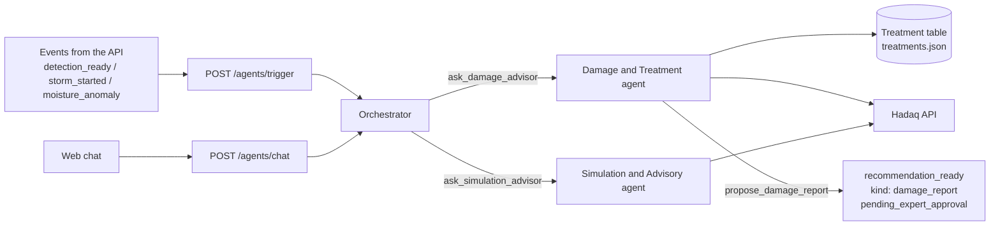

# Hadaq agents

Three LangGraph agents that answer questions and investigate events on their own. They only use real data through tools: the Hadaq API and the team's treatment table. A verifier checks every number they say.

Arabic overview of the idea, the challenge and the plan: [docs/challenge-plan.md](../../docs/challenge-plan.md).



## The agents

| Agent | Job | Tools |
| --- | --- | --- |
| Orchestrator | Reads the building state, sends the work to the right specialist, merges the answer | `get_building_status`, `get_recent_events`, `get_risk`, `ask_damage_advisor`, `ask_simulation_advisor` |
| Damage and Treatment (new) | Turns the latest photo's detections into a damage report: type, zone, severity, treatment, materials, tools, source | `get_damage_findings`, `get_treatment`, `list_damage_types`, `propose_damage_report` |
| Simulation and Advisory | Rain and moisture: runs the wall simulation, compares scenarios, scores risk | `get_building_status`, `run_rain_simulation`, `compare_scenarios`, `get_risk`, `propose_recommendation` |

## Autonomy: two tracks, nobody typing

| Event (forwarded by the API) | Track | What happens |
| --- | --- | --- |
| `detection_ready` with new or grown damage | damage | Findings, a treatment for each, a damage report sent for expert review, an `agent_note` |
| `storm_started`, `moisture_anomaly` | moisture | Simulation, risk, a recommendation if risk is high, an `agent_note` |

Each track has its own cooldown (`TRIGGER_COOLDOWN_S`, per building), so a storm investigation never blocks a photo report.

## The treatment table

`hadaq_agents/treatments.json` is the only place treatments, materials and tools come from. It holds:

- 11 damage types (8 from "الهيئة", 3 team proposals), each in Arabic and English: where it appears, the treatment, materials, tools, things to avoid, and flags (treat the moisture source first, test on a small area first, refer to an engineer).
- `detector_rules`: how a detector class plus the zone's row maps to a damage type. Example: `erosion` in row 1 is base erosion, higher up it is rain gullies. A `moisture_stain` is marked `needs_review` (salt efflorescence or biological growth, the expert decides).
- `crack_width_mm`: fine below 2 mm (injection), wide from 2 mm (stitching), structural from 10 mm (engineer). These thresholds are **ours** (`assumed`); confirm them with a conservator.

Crack width comes from a crack gauge in the same zone (`B01-S06` at `R2C5`), else from the detection mask (`area_cm2 / length_mm`), else it is `unmeasured`. A crack that grew since the last photo is `active`: high priority and a structural engineer checks it before any filling.

To change what the agent recommends, edit the JSON (not the code) and run the tests.

## The look-alike table (v2, DGDA Q8)

`hadaq_agents/lookalikes.json` holds DGDA's 7 cases that look the same in a photo but need different treatments (Q8, table "حالات تتشابه في الصورة ويختلف علاجها"), with the evidence that tells them apart (Q8, table "معلومات لازمة قبل قرار العلاج", plus two items from the Q1 inspection checklist). Arabic is DGDA's wording; English is ours. Which damage type triggers a pair and which evidence goes with it are our decisions, listed per pair under `assumptions`.

`lookalikes.lookalike_for(finding)` takes a v2 `Finding` (or a dict with `damage_type` and `zone_id`) and returns the contract's `Lookalike` (`pair_id`, `options`, `evidence_needed`, `note_ar`) or `None`. `lang="ar"` gives Arabic options and evidence. The dark-stain pair (`dark_stain_base`, on `base_erosion`) applies only on the base row R1. The agent never picks one of the two options; it asks for the evidence and the conservator decides.

`python -m hadaq_agents.lookalikes` prints the table in Arabic as markdown (for the slide and for DGDA to check).

## Damage report payload

`propose_damage_report` posts a `recommendation_ready` event (no contract change: `payload` is free-form). The tool, not the LLM, fills the treatment, materials and tools from the table, so the stored report cannot contain invented items.

```json
{
  "kind": "damage_report",
  "action": "Damage report for expert review, 2 findings: Cracks R2C5, Loss of mud plaster R1C2",
  "action_ar": "تقرير تلف لمراجعة المختص، نتيجتان: التشققات R2C5، فقدان اللياسة R1C2",
  "priority": "high",
  "status": "pending_expert_approval",
  "zone_ids": ["B01-W01-R2C5", "B01-W01-R1C2"],
  "evidence_ids": ["ph_...", "det_...", "rd_..."],
  "report": {
    "items": [{"zone_id": "B01-W01-R2C5", "damage_type": "crack", "severity": "fine", "active": true, "priority": "high",
               "step_en": "Inject the crack with a fine mud grout", "step_ar": "يُحقن الشق بمونة طينية ناعمة",
               "materials_en": ["..."], "tools_ar": ["محقان", "مسطرين", "فرش ناعمة"], "source": "heritage_authority", "...": "..."}],
    "first_steps_en": ["A structural engineer checks R2C5 before any filling or rebuilding"],
    "materials_en": ["..."], "tools_en": ["..."]
  }
}
```

The web shows it in two places: the **Damage map** on the building page (`apps/web/src/building/DamageMap.tsx`: the report drawn on its photo, numbered marks, colour key, treatment card) and the activity feed. The **Damage** layer colours the wall zones on the grid and in 3D with the same colours. Colours are per damage family (cracks and structure, material loss and decay, water damage, past repairs), checked for colour-blind readers; the type is always written next to the mark.

A photo analysed twice stores its detections twice; the agent keeps one finding per zone and class (a grown one first).

## The language model

`HADAQ_LLM` picks the provider and model (`init_chat_model`); `mock` runs the fixed plans. Settings for the current models (`graph.py` `model_settings`):

| Setting | Why |
| --- | --- |
| No `temperature` | Current models reject sampling parameters (a 400 error) |
| `max_tokens` 16000 | Thinking is on by default; a small limit would cut answers |
| `output_config.effort` = `HADAQ_LLM_EFFORT` (default `medium`) | Depth of thinking; medium suits multi-step tool use and keeps the demo quick |
| Server-side fallback (`fallbacks: "default"`) | If the model declines a request, the API answers with a fallback model |
| Cache breakpoint on the system prompt | Tools and system prompt repeat on every call |
| Timeout `HADAQ_LLM_TIMEOUT_S` (90 s), 2 retries | No hanging demo |

If the LLM call fails (network, key, rate limit), the chat and the triggers answer with the fixed plan, labelled "the language model is unavailable right now", so the demo keeps going. An empty answer after a refusal gets a clear message. `GET /health` shows `llm`, `llm_ready` (credentials present, never the key) and `effort`.

`tests/test_llm_contract.py` runs the real client, graph, tools and verifier against a local stand-in for the Messages API (no key, no network). It checks every request (model, `max_tokens`, no sampling parameters, effort, fallback and its beta header, cache breakpoint, each agent's tools, thinking blocks passed back unchanged, parallel tool results in one message) and that responses with thinking, tool calls and text are parsed.

## Guardrails

- Every number in an answer must appear in a tool output (`verifier.py`); otherwise the answer is flagged. Do not loosen the verifier; tighten the prompts.
- Treatments, materials and tools only from the table, with their source; team proposals are labelled as needing a conservator's confirmation.
- Recommendations always wait for expert approval; the agent never says a repair was done.
- Answers follow the user's language (Arabic or English); Arabic uses the table's Arabic text word for word.

## Run

```bash
make api        # API on :8000
make agents     # agents on :8100; HADAQ_LLM=mock works without a key
make vision     # vision worker (mock detector)
```

Mock mode runs fixed plans with the real tools, in Arabic or English. For the real LLM set `HADAQ_LLM` and the API key in `.env` (see `docs/team/omar.md`, section 3).

```bash
curl -s localhost:8100/agents/chat -H 'content-type: application/json' \
  -d '{"message":"Prepare the damage report for expert review","building_id":"B01"}' | python -m json.tool
```

## Tests

`make test`. `tests/test_damage.py` covers the table, the detector rules, crack severity, duplicate detections, the tools against the real API (in-process), the mock answers in both languages, the photo trigger with nobody typing, the per-track cooldown, and the LLM graph with a scripted chat model. `tests/test_llm_contract.py` checks the real client against a stand-in Messages API and the fallback when the LLM fails.
